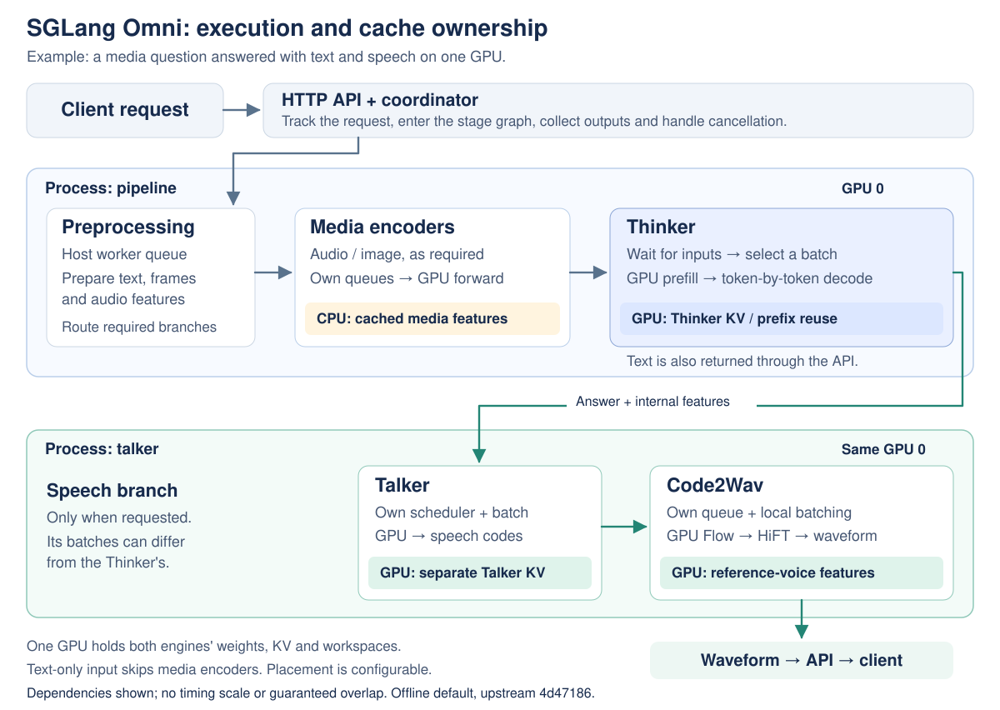

# Omni Inference Lab

Finding and improving bottlenecks in multimodal model serving.

**Omni models** understand combinations of text, images, audio and video, and can answer with text or speech. This project starts with **MiniCPM-o 4.5** on a single **RTX A6000 48 GB**, using **SGLang Omni** to coordinate its inference stages.

## Why study Omni inference?

A text-only language model mainly processes a prompt and generates tokens. An Omni request can also decode video, encode images or audio, and synthesize speech. These stages use different resources and may wait for, or compete with, one another.

We study three questions:

- **Where does the time go?** Follow the complete request, including queues and data movement.
- **What changes under load?** See how concurrent and mixed requests share CPU, GPU and memory.
- **What should we improve?** Use the evidence to choose scheduling, cache, placement or decoding changes, then check response speed and quality.

## The model: which path does a request take?

*Simplified question-answering path. Video can also supply audio; speech output is optional.*

**MiniCPM-o is the model; SGLang Omni is the serving system.** The model defines the computations. The serving system decides when and where those computations run for many requests.

MiniCPM-o 4.5 combines a **SigLip2 vision encoder**, a **Whisper-medium audio encoder**, a **Qwen3-8B language backbone (Thinker)** and a speech branch. An encoder turns media into numerical features. The Thinker reads those features alongside text and generates an answer. For speech, the **Talker** generates speech codes; **Flow** converts them into acoustic features, and **HiFT** converts those features into a waveform. Flow and HiFT together form **Code2Wav**. [Model card](https://huggingface.co/openbmb/MiniCPM-o-4_5) · [Model report](https://arxiv.org/abs/2604.27393).

| Request | Main computation path |
| --- | --- |
| Text question → text | Thinker |
| Image question → text | Vision encoder → Thinker |
| Audio → transcript or text answer | Audio encoder → Thinker; the prompt determines the task |
| Text/audio question → spoken answer | Relevant input path → Thinker → Talker → Code2Wav |
| Video + audio → answer | Selected frames and audio → relevant encoders → Thinker → requested output branch |

**Input + task + output + interaction mode define the workload.** A transcript and a spoken answer to the same recording are different workloads. Real-time conversation also carries state across incoming and outgoing chunks; the offline path below does not describe full-duplex scheduling. [Serving modes](https://sgl-project.github.io/sglang-omni/cookbook/minicpm_o.html).

## The runtime: how SGLang Omni executes the model

SGLang provides batching, prompt processing, token generation and KV management. **SGLang Omni coordinates the surrounding stages**—media preparation, encoders and speech synthesis—alongside those generation engines. [Runtime overview](https://sgl-project.github.io/sglang-omni/developer_reference/main.html).

*Reference layout: upstream's default offline, speech-enabled, single-GPU configuration at [commit 4d47186](https://github.com/sgl-project/sglang-omni/blob/4d47186d9517d36f2c69ae44b9fbadb7bca140b4/sglang_omni/models/minicpm_o/config.py). Arrows show dependencies, not measured durations. Configuration overrides can change placement and process grouping.*

1. **Receive and route.** The coordinator tracks the request; routing selects its required branches.
2. **Prepare and encode.** Host workers prepare media. Encoders compute or reuse features. The Thinker waits for the required inputs.
3. **Read and generate.** The Thinker forms batches. **Prefill** processes input positions; **decode** generates successive tokens using saved attention state.
4. **Produce output.** Tokens become readable text. Speech requests also enter Talker and Code2Wav, each with its own scheduling policy.
5. **Return results.** Outputs or supported streaming chunks return through the API. Transfers and waits also contribute to request latency.

### What happens with several users?

- **Each stage schedules its own work.** Thinker and Talker use SGLang-backed autoregressive schedulers. Preprocessing uses workers; encoders use simpler executors; offline Code2Wav can form its own batch. There is no single batch size for the whole request.
- **Concurrency is not batch size.** Four requests in flight may be waiting at different stages. The Thinker might execute two together while another request is being encoded.
- **A stage is not a GPU.** In the illustrated default, preprocessing, encoders and Thinker share one process; Talker and Code2Wav share another. Both use GPU 0. Separate queues or processes do not guarantee simultaneous GPU execution: sharing can enable overlap or cause contention.

See [scheduler design](https://sgl-project.github.io/sglang-omni/developer_reference/pipeline.html), [process placement](https://sgl-project.github.io/sglang-omni/basic_usage/process_topology.html) and the [pinned stage implementations](https://github.com/sgl-project/sglang-omni/blob/4d47186d9517d36f2c69ae44b9fbadb7bca140b4/sglang_omni/models/minicpm_o/stages.py).

**Live conversations use session scheduling.** Incoming media units arrive while speech is being produced. Thinker and Talker retain conversation state, and ready work from different sessions can be batched. The system must keep up with incoming media and audio playback, not just finish one request quickly. [Full-duplex runtime](https://sgl-project.github.io/sglang-omni/developer_reference/full_duplex_guide.html).

## Memory: what is stored, and where?

**KV cache** stores attention keys and values from earlier sequence positions, so generation can use that history without recomputing it. Media features also occupy positions in the Thinker's sequence: there is not automatically a separate Thinker KV pool for text, images, audio and video.

| Memory or cache | Owner and location in the illustrated GPU configuration | What it is for |
| --- | --- | --- |
| Model weights | Component's assigned device; GPU for the main neural stages | Learned parameters, resident while serving |
| Thinker KV | Thinker engine, GPU | History for understanding inputs and generating text |
| Talker KV | Talker engine, GPU; separate from Thinker KV | History for generating speech codes |
| Prefix reuse | An engine's KV manager, when enabled | Reuse matching prompt history; this can reference the **same KV pool**, not another copy |
| Encoder-output cache | Image/audio encoder executors, **CPU RAM** in the pinned implementation | Reuse encoded media features; these are **not attention KV** |
| Reference-voice cache | Code2Wav, conditioning tensors on its GPU | Reuse features derived from the reference voice |
| Temporary tensors and runtime buffers | CPU/GPU, depending on the stage | Intermediate results, transfers, operator workspaces and CUDA Graph buffers |

**Allocated memory is not the same as active use.** A service can reserve a KV pool once, lend slots to requests and reclaim those slots without lowering `nvidia-smi` memory. Measure pool capacity, active slots and reusable entries separately. A large footprint alone proves neither a leak nor a bottleneck. [Cache ownership, lifecycle and source references](docs/memory.md).

## What we investigate

Follow the **complete request**, then use CPU/GPU traces to explain waits and resource contention. Compare long inputs, concurrent users and mixed tasks; record actual input positions, output lengths and cache hits.

Choose the application metric: first text/audio, smooth playback, complete-response latency or throughput. Test an intervention only after locating a cause, and check output quality alongside performance. [Profiling method](docs/profiling.md).

For current systems ideas, start with **[HorizonServe](related-papers/README.md#horizonserve)** for shared-GPU Omni scheduling, **[RPS-Serve](related-papers/README.md#rps-serve)** for mixed input workloads, and **[OmniCast](related-papers/README.md#omnicast)** for live-session scheduling and KV reuse.

## Explore

- [Architecture and task paths](docs/architecture.md)
- [Memory and caches](docs/memory.md)
- [How to investigate a bottleneck](docs/profiling.md)
- [Related papers and reading order](related-papers/README.md)
- [Relevant upstream investigations](docs/upstream.md)
- [Bottleneck reports](https://github.com/bairixie/omni-inference-lab/issues) — evidence, reproduction and follow-up optimization.

Official references: [MiniCPM-o 4.5](https://huggingface.co/openbmb/MiniCPM-o-4_5) · [SGLang Omni](https://sgl-project.github.io/sglang-omni/developer_reference/main.html).
