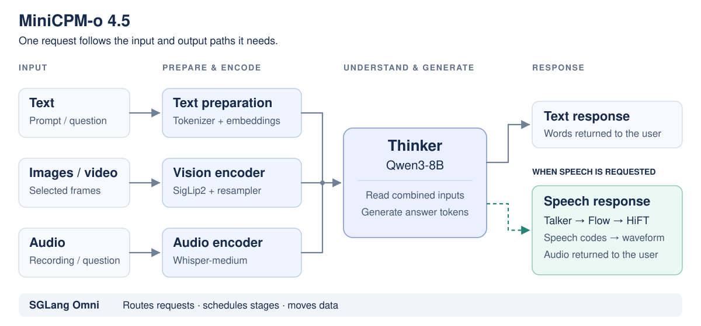

# Omni Inference Lab

Finding and improving bottlenecks in multimodal model serving.

**Omni models** understand combinations of text, images, audio and video, and can answer with text or speech. This project starts with **MiniCPM-o 4.5** on a single **RTX A6000 48 GB**, using **SGLang Omni** to coordinate its inference stages.

## Why study Omni inference?

A text-only language model mainly processes a prompt and generates tokens. An Omni request can also decode video, encode images or audio, and synthesize speech. These stages use different resources and may wait for, or compete with, one another.

We study three questions:

- **Where does the time go?** Follow the complete request, including queues and data movement.
- **What changes under load?** See how concurrent and mixed requests share CPU, GPU and memory.
- **What should we improve?** Use the evidence to choose scheduling, cache, placement or decoding changes, then check response speed and quality.

## How the pieces fit

*Simplified question-answering path. Video can also supply audio; speech output is optional.*

**MiniCPM-o is the model:** its encoders interpret media, its language backbone generates answers, and its speech branch produces audio. **SGLang Omni is the serving system:** it routes work, schedules stages and transfers their outputs.

## Explore

- [Architecture and task paths](docs/architecture.md)
- [Memory and caches](docs/memory.md)
- [How to investigate a bottleneck](docs/profiling.md)
- [Relevant upstream investigations](docs/upstream.md)
- [Bottleneck reports](https://github.com/bairixie/omni-inference-lab/issues) — evidence, reproduction and follow-up optimization.

Official references: [MiniCPM-o 4.5](https://huggingface.co/openbmb/MiniCPM-o-4_5) · [SGLang Omni](https://sgl-project.github.io/sglang-omni/developer_reference/main.html).
