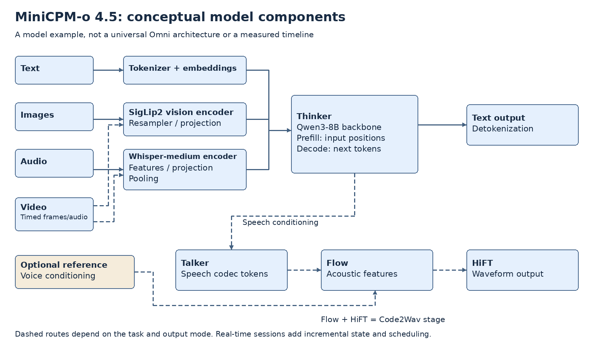
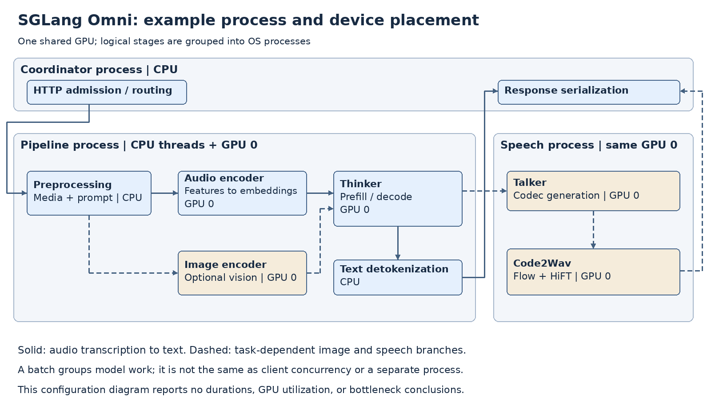

# Omni Inference Lab

**Omni Inference Bottleneck Research and Optimization**

## Project purpose

This project studies what limits the performance of multimodal inference and how to improve it without reducing output quality. It starts with reproducible measurement and local validation. Optimization is a research goal, not a claim that this repository already contains an optimized system.

An **Omni model** can connect several kinds of input and output, such as text, images, audio, video, and speech. A request is defined by its input, task, output, and service mode. Transcribing an audio clip into text and answering a question from that clip with speech are different workloads, even when their input file is identical.

## Why Omni inference needs its own bottleneck analysis

A text language model converts text into tokens and generates new tokens. Multimodal inference can add media decoding, resampling, image transforms, modality encoders, and speech synthesis. These stages have different amounts of work and different dependencies. A long audio clip may need more encoder work and may also lead to a much longer written answer. A speech response adds another generation path after the language model.

Stages may overlap, wait for one another, or compete for the same CPU and GPU. Streaming adds deadlines: producing a complete answer quickly does not necessarily mean producing every audio chunk on time. Scheduling, data transfer, synchronization, and cache lifetimes therefore need to be understood together. Text-only serving also has complex scheduling, caching, and synchronization; these concerns are not exclusive to Omni systems.

These are reasons to investigate. They do not establish that every possible limitation occurs in a particular deployment. We first define the end-to-end metric, follow actual requests, and separate waiting from useful work. A proposed optimization then needs a controlled comparison and a quality check.

## Model architecture and task paths

MiniCPM-o 4.5 is one concrete example. Its language backbone is Qwen3-8B. A SigLip2 vision encoder and a Whisper-medium audio encoder turn media into representations the language model can use. Its speech output system is based on CosyVoice2. The names and arrangement below describe this model and its SGLang Omni implementation; they are not a universal architecture for all Omni models.

- A **token** is a numbered unit in a model's vocabulary. A text token can represent part of a word. Audio codec tokens represent speech information rather than written words.
- An **embedding** is a vector representation. Media embeddings occupy language-model sequence positions even though they are not ordinary text words.
- The **Thinker** is the language generation path. During **prefill**, it processes the prompt and media positions. During **decode**, it repeatedly produces the next token using the previous context.
- The **Talker** generates speech codec tokens from language-model conditioning. **Flow** converts codec information and optional reference-voice conditioning into acoustic features. **HiFT**, a neural vocoder, converts those features into a waveform. Flow and HiFT form the implementation's **Code2Wav** stage.

*Conceptual component diagram, not a measured trace. Editable [Mermaid](docs/figures/model-components.mmd) and [SVG](docs/figures/model-components.svg) are included.*

Text goes to the language path. Images go through vision encoding. Audio transcription and audio question answering use audio encoding followed by language generation, with different instructions and expected outputs. Text or audio can also condition a speech response. Video can supply timed images and audio. Real-time duplex interaction adds a session protocol, incremental perception, and speech/listening coordination; it cannot be inferred from an ordinary offline request.

The [architecture guide](docs/architecture.md) explains these branches and the difference between model capability, configuration, and an observed execution path. Official capability descriptions are not evidence that a local deployment has tested every mode.

## SGLang Omni as the inference system

The model defines the computation and learned weights. **Transformers** provides model/configuration interfaces, tokenizers, and processors; it can also run reference implementations. **SGLang Omni** organizes multimodal serving into stages. **SGLang** supplies the language-generation scheduler, attention implementation, and KV allocation used by the autoregressive stages. The **GPU** executes tensor operations; the CPU handles orchestration and other processing. A Python package version alone does not identify which source files a service actually imported.

A **coordinator** tracks requests and routes their data. A **stage** is a logical unit of work. A **scheduler** chooses when that stage runs and which requests can share a **batch**, one model execution containing work from multiple requests. Client concurrency is the number of requests in flight; it is not automatically the model's actual batch size. Stages can share a process, and multiple processes can share one GPU.

*Concrete deployment example based on a frozen configuration: one GPU, a coordinator process, a pipeline process, and a speech process. Solid arrows show the audio-to-text route; dashed arrows show optional branches. This is a placement diagram, not a latency plot. Editable [Mermaid](docs/figures/system-path.mmd) and [SVG](docs/figures/system-path.svg) are included.*

## Memory and cache overview

Weights persist while model components are loaded. Attention **KV caches** store keys and values for sequence positions, allowing later tokens to reuse earlier computation. An allocator can reserve a large KV pool while only a small part is assigned to active requests. Returning slots to that pool does not return the pool's physical memory to the GPU driver.

A **prefix cache** can retain reusable rows in the same KV pool; it is not necessarily another allocation to add to the total. Encoder caches retain media representations. Reference caches retain voice-conditioning information. Temporary activations, operator workspaces, CUDA Graph storage, and communication buffers have other lifetimes. Different tasks activate different components and reuse opportunities. The [memory guide](docs/memory.md) explains what can be counted and what remains ambiguous.

## Repository organization and references

| Location | Purpose |
|---|---|
| [docs/](docs/architecture.md) | Architecture, memory, measurement rules, and scoped upstream references |
| [experiments/minicpmo_a6000_asr/](experiments/minicpmo_a6000_asr/README.md) | Frozen configuration, source/audio manifests, and reproduction guidance |
| [scripts/](scripts/README.md) | Offline verification and small runtime adapters |
| [patches/](patches/README.md) | A correctness backport and measurement hooks against a fixed upstream commit |
| [instrumentation/](instrumentation/README.md) | Request, batch, and process observations |
| [evidence/](evidence/README.md) | Small attachments for findings that pass the issue evidence criteria |

The stable [Issues entry](docs/issues.md) describes where confirmed bottleneck reports belong. Qualifying reports belong in the repository's GitHub Issues, with versioned attachments here. Internal investigations and baseline records are not automatically issue reports.

Background sources: [MiniCPM-o 4.5 model card](https://huggingface.co/openbmb/MiniCPM-o-4_5), [official demo](https://github.com/OpenBMB/MiniCPM-o-Demo/tree/main/MiniCPMO45), and [SGLang Omni developer guide](https://sgl-project.github.io/sglang-omni/developer_reference/main.html). [Related work](docs/related-work.md) identifies upstream results as other authors' work and preserves their task, version, and hardware scope.
